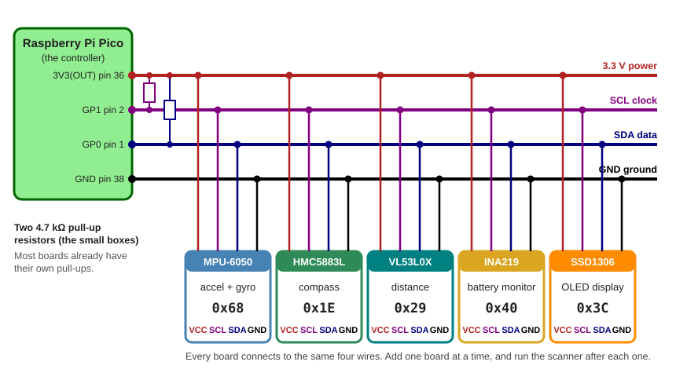
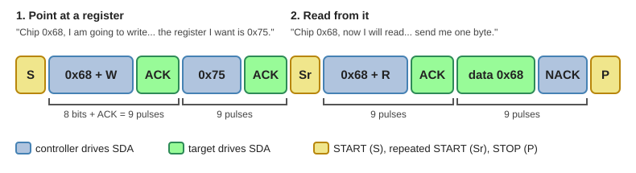

# Appendix A: The I2C Bus

By the end of this appendix you'll be able to:

- Explain how the Pico uses two wires to talk to many chips, and how it picks one chip by its address
- Turn the raw bytes from a sensor into a real number with Python
- Describe how the Pico takes turns with five devices, and why a slow display can delay the sensors

A robot is full of small chips. One feels motion. One finds north. One measures
distance. One watches the battery. One drives a screen. Each chip needs to talk to
the Pico. But the Pico only has so many pins. This appendix shows the trick that
lets one Pico talk to dozens of chips using just two wires.

!!! mascot-welcome "Welcome to the I2C Bus!"
    { class="mascot-admonition-img" }
    Today you will peek inside a robot and watch its chips talk, one polite turn at a time. You will scan a bus, read raw bytes, and see why a screen can slow down a sensor. Let's build something amazing!

## I2C in One Minute

Here is the whole idea at a glance. Every term in this table gets its own
explanation below.

| Question | Answer |
|----------|--------|
| What is it? | A two-wire bus that connects the Pico to many small chips |
| What are the wires? | Serial Clock (SCL) and Serial Data (SDA) |
| Who is in charge? | One controller (your Pico). It starts every conversation |
| How does it pick a chip? | Every chip has a 7-bit address. The controller says the address first |
| How does a chip say "yes"? | It pulls SDA low for one clock pulse. That is an acknowledge (ACK) |
| Can two chips talk at once? | No. There is one conversation at a time, so the Pico takes turns |
| How fast? | 100,000 or 400,000 bits per second on most boards |

I2C is short for Inter-Integrated Circuit. You say it "eye-squared-see". Philips
(now NXP) invented it in the early 1980s. [Chapter 8](../../chapters/08-communication-protocols/index.md)
introduced I2C. This appendix goes much deeper. The [Protocol Comparison Explorer](../../sims/protocol-comparison/index.md)
MicroSim shows how I2C compares with SPI and UART.

## 1. What Is a Bus?

Picture a classroom where the teacher asks questions. Every student hears every
question. But each question starts with a name: "Maya, what is 7 times 8?"
Only Maya answers. Everyone else stays quiet and listens for their own name.

A **bus** works the same way. It is a set of shared wires that many chips connect to.
Every chip hears everything the Pico sends. Each message starts with an address.
Only the chip that owns that address answers.

Why share wires instead of giving every chip its own? Count the pins.

| Connection | Signal wires | Chips on the same wires | Typical use |
|------------|--------------|-------------------------|-------------|
| I2C | 2 (SDA, SCL) | up to 112 | sensors, small displays, clocks |
| SPI | 3, plus 1 more for each chip | a few | fast displays, SD cards |
| UART | 2 for each pair of chips | exactly 2 | GPS, serial consoles |

With I2C you can add a sixth, seventh or tenth chip. The Pico still uses the same two
pins. That is why robots, phones and laptops are full of I2C.

## 2. Meet the Hardware

The robot in this appendix uses the parts below. The table lists each chip, what it
does, and its address. The five-device MicroSim near the end uses everything except
the compass.

| Device | Chip (breakout board) | What it does | I2C address |
|--------|-----------------------|--------------|-------------|
| Accelerometer | MPU-6050 (GY-521) | feels pushes and gravity | `0x68` |
| Gyroscope | MPU-6050 (same chip) | feels how fast the robot turns | `0x68` |
| Compass | HMC5883L (GY-271) | senses Earth's magnetic field | `0x1E` |
| Distance sensor | VL53L0X | times a pulse of light to an obstacle | `0x29` |
| Battery monitor | INA219 | measures battery voltage and current | `0x40` |
| Display | SSD1306 128x64 OLED | shows text and pictures | `0x3C` |

(OLED stands for organic light-emitting diode. It is a screen where every pixel makes its own light.)

The accelerometer and the gyroscope are one chip with one address. They are two
sensors, but only one device on the bus. Leave out the compass and the other five
functions need just four addresses: `0x68`, `0x29`, `0x40` and `0x3C`. Add the
compass back and you have five addresses for six functions.

[Chapter 10](../../chapters/10-motion-light-sensors/index.md) shows the MPU-6050 and the
compass. [Chapter 9](../../chapters/09-temp-distance-sensors/index.md) covers the VL53L0X
distance sensor. [Chapter 15](../../chapters/15-oled-setup/index.md) sets up the OLED display.

!!! warning "Parts notes: read these before you buy"
    - **Compass clones.** Many boards sold as "GY-271 / HMC5883L" now hold a different chip, the QMC5883L. It answers at `0x0D`, not `0x1E`. Some hold a QMC5883P at `0x2C`. An I2C scan tells you in seconds which chip you have. The code for each chip is different.
    - **Combo boards.** Some boards put an MPU-6050 and an HMC5883L together (GY-86 and GY-87). The compass hangs off the MPU-6050's own private bus. To see it from the Pico, turn on the MPU-6050's *bypass mode*. That is bit 1 of register `0x37`.
    - **Age.** The MPU-6050 and HMC5883L are older parts. They are cheap and well documented, so they are great for learning. Check that you can still buy them before you design a product around them.

### Wire the Bus

Every device connects to the same four lines. Wiring a new device means adding one more
set of wires to the same rows. Follow these steps in order.

1. Unplug the Pico from USB.
2. Connect Pico pin 36 (3V3 OUT) to the VCC pin of every board. All the boards run on 3.3 volts.
3. Connect Pico pin 38 (GND) to the GND pin of every board.
4. Connect Pico pin 1 (GP0) to the SDA pin of every board.
5. Connect Pico pin 2 (GP1) to the SCL pin of every board.
6. Add one board at a time. Run the scanner (see Section 5) after each board. Exactly one new address should appear.



In MicroPython, `I2C(0, sda=Pin(0), scl=Pin(1))` is the bus these pins belong to. The
Pico has two I2C buses. I2C0 can use GP0/GP1, GP4/GP5 and other pairs. I2C1 can use
GP2/GP3, GP6/GP7 and other pairs.

!!! tip "Safety first"
    The INA219 sits between the battery and the robot, so it handles real power. Ask an adult to help with anything that touches a LiPo battery. Never let bare battery wires touch each other.

## 3. Two Wires: SDA and SCL

I2C uses exactly two signal wires.

- **SCL** (Serial Clock) is the clock. The Pico ticks it like a metronome. One tick moves the conversation along by one bit.
- **SDA** (Serial Data) carries the bits, one for each tick. Bits travel both ways on this wire. Only one chip talks at a time, so the wire can be shared.

The rule for data is simple. The sender may change SDA only while SCL is low. The
receiver reads SDA while SCL is high. So the bits hold still at the moment someone
looks at them.

### Pull-up Resistors: Why a Wire Only Goes One Way

Here is a surprise. No chip on an I2C bus may push a wire *high*. A chip can only pull
a wire *down* to ground, or let go.

Imagine a spring holding a rope up. A chip can pull the rope down. When it lets go,
the spring pulls the rope back up. The spring is a **pull-up resistor**. It is a small
resistor (4,700 ohms is typical) from each wire to the 3.3 volt line. When nobody pulls,
the resistor keeps the wire high. When any chip pulls, the wire goes low.

This design solves two problems:

1. **No short circuits.** If one chip pushed high while another pulled low, they would fight. With pull-down only, the worst case is a polite tie.
2. **ACK works.** During the ACK pulse, the Pico lets go of SDA. If a chip pulls it low, the Pico reads a 0. If nobody does, the resistor keeps it high and the Pico reads a 1.

Most breakout boards carry their own pull-up resistors, so the bus usually works with no
extra parts. The Pico's built-in pull-ups are weak, so count on the ones on the boards.

### START, STOP and Speed

Two special moments mark the start and end of a conversation. Both happen while SCL
is high. That is normally when SDA must hold still.

- **START:** SDA falls while SCL is high. It means "I am about to talk."
- **STOP:** SDA rises while SCL is high. It means "I am done. The bus is free."

Most boards run the bus at 100,000 bits per second (**standard mode**). Some run it at
400,000 bits per second (**fast mode**). MicroPython uses 400,000 unless you pass a
different `freq`.

!!! info "Controller and target"
    Older books call the Pico the "master" and the chips "slaves". Since Revision 7.0 (2021), the official I2C specification from NXP says **controller** and **target**. The MicroPython documentation says *controller* and *peripheral*. This appendix uses controller and target.

## 4. Anatomy of a Transaction

Every conversation is called a **transaction**. Every transaction follows the same script:

1. The controller sends START.
2. The controller sends the **address**. That is 7 bits, then one **R/W bit**. A 0 means "I will write to you." A 1 means "I want to read from you."
3. The target that owns the address sends an **ACK**. If nobody does, the controller sees a **NACK** and knows nobody is home.
4. Data bytes follow, 8 bits each. After every byte, the *receiver* sends an ACK to say "got it."
5. The controller sends STOP.

Every byte takes 9 clock pulses. That is 8 bits plus 1 ACK bit. Remember "nine bits
per byte." You will use it to work out how long things take.

Reading from a chip takes two steps. The chip first needs to know *which* of its
numbers you want. The diagram shows a real read of the MPU-6050's identity register,
`0x75`.



Look at the colors. Blue boxes come from the controller. Green boxes come from the
target. The target only speaks for the ACKs and the data byte.

Notice the **repeated START** (Sr). The controller does not let go of the bus between
"point at a register" and "read from it." It starts again right away. No other
controller can slip in between.

The last byte ends with a NACK from the *controller*. That is not an error. It means
"that was the last byte I want." The target stops driving SDA so the controller can send STOP.

### Why Two Devices Never Get Confused

The diagram above shows one target. Real buses usually carry several. Here is the
question that trips people up: if a target like an EEPROM gets sent a *data* byte that
happens to match some other chip's address, does that other chip wake up and answer by
mistake?

No -- and the reason is timing, not luck. A target only compares a byte to its own
address **immediately after a START or repeated START**. The moment the address byte
does not match, a target stops listening and ignores every byte that follows, no matter
what it contains, until the bus sees a START again. So an EEPROM's internal memory
address can never be mistaken for another chip's device address, even if the numbers
collide, because the chip that did not match already dropped off the bus.

**How to use this MicroSim:** Press **Next** or **Play** to step through a real
transaction, byte by byte: a controller writes a 16-bit memory address to an EEPROM at
`0x50`, then reads one byte back, while an LCD backpack at `0x27` shares the same wires.
Watch the LCD panel switch to "ignoring the bus" right after the first address byte --
and stay that way through both memory-address bytes -- until the repeated START wakes it
up to check again.

<iframe src="../../sims/i2c-start-bit-framing/main.html" height="702" width="100%" scrolling="no"></iframe>

[Explore the I2C Start Bit and Address Framing MicroSim](../../sims/i2c-start-bit-framing/index.md){ .md-button }

## 5. Addresses and the I2C Scanner

Seven address bits give 128 possible addresses, `0x00` to `0x7F`. Sixteen are reserved
for special jobs (`0000 XXX` and `1111 XXX` in the I2C specification). That leaves
`0x08` to `0x77`, or **112 usable addresses**. Chapter 8 says "up to 127 devices". That
is the number of addresses a 7-bit number can hold. The scanner only asks the 112 that
chips are allowed to use.

Here are our devices written three ways:

| Device | Hex | Decimal | 7-bit binary |
|--------|-----|---------|--------------|
| HMC5883L compass | `0x1E` | 30 | `0011110` |
| VL53L0X distance | `0x29` | 41 | `0101001` |
| SSD1306 display | `0x3C` | 60 | `0111100` |
| INA219 battery | `0x40` | 64 | `1000000` |
| MPU-6050 accel + gyro | `0x68` | 104 | `1101000` |

!!! mascot-tip "Monty's Hex Helper"
    { class="mascot-admonition-img" }
    `0x68` is just a number written in base 16, and the `0x` means "hex". Python prints it with `hex(104)` and accepts it anywhere a number goes, so `0x68 == 104` is `True`.

Datasheets can confuse you here. The HMC5883L datasheet lists the *8-bit* write address
`0x3C` and read address `0x3D`. Those are the 7-bit address `0x1E` shifted left one
place, with the R/W bit added. MicroPython uses the 7-bit address, `0x1E`. (The book's
`hmc5883l.py` driver says `address=30`, which is `0x1E` in decimal.) And that `0x3C` is
not the SSD1306 display. The display's 7-bit address just happens to be `0x3C` too.

### How the Scanner Works

Run a **scan** the first time you use any new bus. A scan asks every address, one after
another, "is anyone there?" The MicroPython documentation says it this way. `i2c.scan()`
tries every address from `0x08` to `0x77`. A device responds if it pulls SDA low after
its address, including the write bit, is sent.

This is the big idea: **devices never announce themselves.** The Pico asks. Only the
owner of the address answers. Here is a complete scanner:

```python
# i2c-scanner.py: find every chip on the I2C bus
from machine import Pin, I2C

sda_pin = Pin(0)                   # GP0 carries the data wire (SDA)
scl_pin = Pin(1)                   # GP1 carries the clock wire (SCL)
i2c = I2C(0, sda=sda_pin, scl=scl_pin, freq=400000)   # bus 0 at 400 kHz

print("Scanning the I2C bus...")
device_list = i2c.scan()           # ask every address, keep the ones that answer

if len(device_list) == 0:
    print("No devices found. Check your wiring!")
else:
    for address in device_list:    # one pass for each chip that answered
        print("Found a device at", hex(address), "=", address, "decimal")
    print(len(device_list), "device(s) found.")
```

| Line | What it does |
|------|--------------|
| `from machine import Pin, I2C` | Loads the tools for pins and for the I2C bus |
| `sda_pin = Pin(0)` | Names the pin that carries data (GP0) |
| `scl_pin = Pin(1)` | Names the pin that carries the clock (GP1) |
| `i2c = I2C(0, ...)` | Sets up I2C bus 0 on those pins at 400,000 bits per second |
| `device_list = i2c.scan()` | Asks addresses `0x08` to `0x77` and returns the ones that said ACK |
| `for address in device_list:` | Repeats the next line once for each chip found |
| `print(... hex(address) ...)` | Shows the address in hex and in decimal |

With our parts wired up, it prints `Found a device at 0x1e = 30 decimal`, then
`0x3c = 60`, then `0x68 = 104`. Try it in slow motion below. Press **Step** to ask one
address at a time. Or slow the speed slider all the way down and follow the clock and
data traces bit by bit. Then unplug a chip and scan again.

**How to use this MicroSim:** Press **Step** or **Start**. Uncheck a chip to unplug it. Then press **Scan again**.

<iframe src="../../sims/i2c-scanner/main.html" height="692" width="100%" scrolling="no"></iframe>

[Explore the I2C Bus Scanner MicroSim](../../sims/i2c-scanner/index.md){ .md-button }

### What If Two Chips Have the Same Address?

Then the bus cannot tell them apart. Both would answer at once. Every designer meets this
problem sooner or later. There are four ways out:

| Fix | How it works | Example |
|-----|--------------|---------|
| Address pin | Many chips have a pin that changes one address bit | MPU-6050: `AD0` low is `0x68`, high is `0x69`. INA219 breakout: jumpers `A0` and `A1` give `0x40`, `0x41`, `0x44` or `0x45` |
| Change it in software | Some chips let you write a new address, so wake them one at a time | VL53L0X: use its `XSHUT` pin to wake one chip at a time |
| A second bus | Use another pair of pins | The Pico has two buses: I2C0 and I2C1 |
| A multiplexer | A chip that switches the bus between several branches | TCA9548A |

### Try It: A Pretend Bus

You can practice the scan loop without any chips. The program below pretends to be a
bus. A dictionary holds the chips. A loop asks every address, just like `i2c.scan()`.
It runs on the Pico, or on any computer with Python.

!!! mascot-thinking "What Do You Think Will Happen?"
    { class="mascot-admonition-img" }
    The dictionary lists the MPU-6050 first. Before you run it, guess which device the scan prints first. Then find out!

```python
# pretend_bus.py: practice the scan loop with no hardware
pretend_bus = {
    0x68: "MPU-6050 accelerometer and gyroscope",
    0x1E: "HMC5883L compass",
    0x3C: "SSD1306 display",
}

answered = []                          # addresses that said ACK
for address in range(0x08, 0x78):      # the same range as i2c.scan()
    if address in pretend_bus:         # some chip owns this address
        answered.append(address)       # remember it

print("Scanning the pretend bus...")
for address in answered:
    print("Found a device at", hex(address), "=", address, "->", pretend_bus[address])
print(len(answered), "devices found.")
```

| Line | What it does |
|------|--------------|
| `pretend_bus = { ... }` | A dictionary. Each key is an address and each value is a chip name |
| `answered = []` | An empty list that will hold the addresses that answered |
| `for address in range(0x08, 0x78):` | Counts through every address a scan asks |
| `if address in pretend_bus:` | Is a chip living at this address? |
| `answered.append(address)` | Adds the address to the list |
| `print(... pretend_bus[address])` | Looks up the chip's name and prints it |

Were you right? The output is:

```
Scanning the pretend bus...
Found a device at 0x1e = 30 -> HMC5883L compass
Found a device at 0x3c = 60 -> SSD1306 display
Found a device at 0x68 = 104 -> MPU-6050 accelerometer and gyroscope
3 devices found.
```

The scan walks the addresses *upward* from `0x08`. So it meets `0x1E` first, no matter
how the dictionary is ordered. A real scanner always lists chips from the lowest address
to the highest.

## 6. Registers: The Mailboxes Inside a Chip

The address picks the chip. But a chip holds many separate numbers. It holds settings,
results and an identity code. Each one lives in a numbered slot called a **register**.
Think of the numbered lockers in a school hallway. The address chooses the hallway. The
register number chooses the locker.

MicroPython gives you two helpers that do the whole "point at a register, then read"
dance from the diagram in one call:

```python
who_am_i = i2c.readfrom_mem(0x68, 0x75, 1)   # chip 0x68, register 0x75, read 1 byte
print(who_am_i[0])                           # prints 104, which is 0x68

i2c.writeto_mem(0x68, 0x6B, b'\x00')         # write the value 0 into register 0x6B
```

| Line | What it does |
|------|--------------|
| `i2c.readfrom_mem(0x68, 0x75, 1)` | Reads 1 byte from register `0x75` of the chip at `0x68` |
| `who_am_i[0]` | Takes the first (and only) byte as a number |
| `i2c.writeto_mem(0x68, 0x6B, b'\x00')` | Writes one byte, with the value 0, into register `0x6B` |

Reading the identity register is the "hello" of I2C. The MPU-6050 answers `0x68` from
its `WHO_AM_I` register. If you get that back, your wiring and your address are right.

Here are the registers this robot needs. You do not have to memorize them. The
datasheets list the rest.

| Chip | Register | Name | What it holds |
|------|----------|------|---------------|
| MPU-6050 `0x68` | `0x6B` | `PWR_MGMT_1` | write `0` to wake the chip (it powers up *asleep*) |
| | `0x75` | `WHO_AM_I` | always reads `0x68` |
| | `0x1C` | `ACCEL_CONFIG` | accelerometer range: ±2, ±4, ±8 or ±16 g |
| | `0x1B` | `GYRO_CONFIG` | gyroscope range: ±250 up to ±2000 degrees per second |
| | `0x3B`-`0x40` | `ACCEL_XOUT_H` ... | accelerometer X, Y, Z (high byte, then low byte) |
| | `0x41`-`0x42` | `TEMP_OUT_H` ... | chip temperature |
| | `0x43`-`0x48` | `GYRO_XOUT_H` ... | gyroscope X, Y, Z (high byte, then low byte) |
| HMC5883L `0x1E` | `0x02` | Mode | `0x00` = measure all the time (the chip powers up in *single-measurement* mode) |
| | `0x03`-`0x08` | Data output | compass X, *Z*, Y (high byte first). Yes, Z comes before Y |
| | `0x0A`-`0x0C` | ID A, B, C | `0x48`, `0x34`, `0x33`, the letters "H43" |
| VL53L0X `0x29` | `0xC0` | Model ID | reads `0xEE` |
| | `0x1E` | Range result | the distance in millimeters, 16 bits |
| INA219 `0x40` | `0x02` | Bus voltage | battery voltage (see Section 7) |
| | `0x01` | Shunt voltage | tiny voltage across the shunt resistor (10 microvolts per step) |
| | `0x04` | Current | amps, after you write a calibration number to `0x05` |
| SSD1306 `0x3C` | control byte | `0x00` or `0x40` | the byte after the address says "commands follow" (`0x00`) or "pixels follow" (`0x40`) |

**A common mistake:** the MPU-6050 starts in sleep mode. In sleep mode every reading is
zero. If your accelerometer prints all zeros, write `0` to register `0x6B` first.

The VL53L0X is a laser distance sensor with a long start-up recipe of dozens of register
writes. The book's `VL53L0X.py` driver does that recipe for you. You will use it in
Section 10. The I2C part, reading two bytes, is the easy part.

## 7. From Bytes to Numbers

A register is only 8 bits wide. A sensor reading needs more detail than that. So the
chips use **two bytes** for each reading. They send the **high byte** first. The
MPU-6050, HMC5883L, INA219 and VL53L0X all do this. To rebuild the number, shift the
high byte left 8 places. Then **OR** the low byte in:

```python
raw_value = (high_byte << 8) | low_byte   # glue the two bytes into one number
```

There is one more trick. An accelerometer feels pushes in *both* directions, so the
number can be negative. Chips store negative numbers in a format called **two's
complement**. A 16-bit number from `0x8000` upward means "negative." To convert it,
subtract 65,536:

```python
if raw_value >= 0x8000:                   # the top bit is set, so the number is negative
    raw_value = raw_value - 0x10000       # same as: raw_value - 65536
```

In MicroPython, `struct.unpack('>hhh', data)` does both steps for three readings at once.
The `>` means "high byte first." The `h` means "signed 16-bit number."

Next, turn the raw count into a real unit. The scale depends on the range you picked
in the config register:

| Sensor | Setting | Raw counts for each unit |
|--------|---------|--------------------------|
| Accelerometer | ±2 g (default) | 16,384 per g |
| | ±4 g / ±8 g / ±16 g | 8,192 / 4,096 / 2,048 per g |
| Gyroscope | ±250 °/s (default) | 131 per degree per second |
| | ±500 / ±1000 / ±2000 °/s | 65.5 / 32.8 / 16.4 |
| Compass | ±1.3 gauss (default) | 1,090 per gauss |
| Battery (INA219) | bus voltage | shift right 3 bits, then 4 millivolts per step |
| Distance (VL53L0X) | | already millimeters |

(A "g" is the pull of gravity. At rest, an accelerometer reads 1 g straight down.)

The INA219 needs an example. Say the two bytes from register `0x02` are `1F A0`.
Together that is `0x1FA0`, or 8096. The lowest three bits are status flags, not
voltage. So shift them away: `8096 >> 3` is 1012. Each step is 4 millivolts, so
1012 × 0.004 is **4.048 volts**. That is a nearly full LiPo battery. The chip never says
"percent." Your program has to look the voltage up in a battery curve itself.

### Learning Check: The Robot That Brakes at 3.9 g

!!! mascot-warning "Spot the Bug!"
    { class="mascot-admonition-img" }
    The robot is braking *gently*, but this program says 3.89 g. That would squash a real robot! The bytes are right, but the program forgot that readings can be negative. Fix it so it prints about -0.11 g.

```python
# braking_bug.py: this program has a bug. Can you find it?
high_byte = 0xF9                          # bytes from the x-axis while braking gently
low_byte = 0x25

raw_value = (high_byte << 8) | low_byte   # glue the two bytes into one number
accel_g = raw_value / 16384               # 16384 counts = 1 g
print("raw number:", raw_value)
print("acceleration:", round(accel_g, 2), "g")
```

Run it first. It prints `raw number: 63781` and `acceleration: 3.89 g`. Hint: a 16-bit
number of `0x8000` (32,768) or more is really a negative number. Add an `if` check
*before* the line that works out `accel_g`.

??? question "Show me the fix (try it yourself first!)"
    Add these two lines right after `raw_value` is built:

    ```python
    if raw_value >= 32768:                # the top bit means "negative"
        raw_value = raw_value - 65536     # turn it into a negative number
    ```

    Now `raw number` is `-1755`. And -1755 divided by 16,384 is about **-0.11 g**.

### Put It to Work: A Collision-Avoidance Robot

You can now read a distance from the VL53L0X. Next, use it. In this MicroSim, a robot
drives around an arena with only one sensor. The Pico reads the distance over I2C again
and again. When the wall is 15 centimeters away or closer, the robot backs up 20
centimeters. Then it flips a coin and turns left or right.

**How to use this MicroSim:** Press **Start**. Watch the I2C log and the two data bytes. Then set **Reads per second** to 1 and **Robot speed** to 40.

<iframe src="../../sims/i2c-collision-avoidance/main.html" height="679" width="100%" scrolling="no"></iframe>

[Explore the I2C Collision-Avoidance Robot MicroSim](../../sims/i2c-collision-avoidance/index.md){ .md-button }

Find the line in the log marked `TOO CLOSE!`. The two bytes on that line are the sensor's
answer. Join them and you get millimeters. For example, `00 94` is `0x0094`, which is 148
millimeters, or 14.8 centimeters. That is under 15, so the robot backs up.

The robot only knows the distance when a read finishes. Between reads, it drives blind.
At 20 cm per second and 10 reads per second, the robot moves 2 cm between reads. That is
safe. At 40 cm per second and 1 read per second, it moves 40 cm between reads. Then it
bumps the wall. Speed divided by reads per second tells you how far the robot goes before
it can react.

The code is short. The [collision-avoidance robot kit](../../kits/maker-pi-rp2040-robot/20-collision-avoidance-robot.md)
has a full program. The MicroSim page shows the main loop line by line.

## 8. Two Sensors, One Bus

Now put the pieces on a moving robot. In this MicroSim, a robot drives through a maze.
The Pico reads the **accelerometer** and then either the **gyroscope** (the same chip)
or the **compass** (a different chip).

**How to use this MicroSim:** Press **Start**. Drag **Reads per second**. Switch **Second sensor** between the gyroscope and the compass.

<iframe src="../../sims/i2c-two-sensors-maze/main.html" height="677" width="100%" scrolling="no"></iframe>

[Explore the I2C Two Sensors in a Maze MicroSim](../../sims/i2c-two-sensors-maze/index.md){ .md-button }

It looks like both sensors send their numbers at the same time. They cannot. I2C has one
controller and one conversation at a time. The Pico does this:

1. Ask the accelerometer for its 6 bytes. Wait for them to arrive.
2. Ask the gyroscope (or compass) for its 6 bytes. Wait for them to arrive.
3. Use the numbers.
4. Repeat.

Each read takes only a tiny fraction of a millisecond. So it *feels* like both happen at
once. The timeline at the bottom of the MicroSim stretches the reads so you can see the
blocks take turns and never overlap.

**Think about it:** switch the second sensor from gyroscope to compass and watch the bus
diagram. The gyroscope shares the MPU-6050's address `0x68`. The compass is a separate
chip at `0x1E`. In the code, what changes between the two reads? Only the address and
the register number. The Pico always does the same "point at a register, then read
bytes" dance.

### What Each Sensor Feels

| What the robot does | Accelerometer | Gyroscope | Compass |
|---------------------|---------------|-----------|---------|
| Sits still | reads 1 g straight down (gravity) | reads about 0 | reads a steady heading |
| Speeds up or brakes | pushes forward or backward | stays near 0 | steady |
| Turns in place | stays near 0 | spikes: one sign for right, the other for left | heading changes by 90° |
| Gets bumped | big noisy spike | small blip | small blip |

The accelerometer feels *pushes*, including gravity. The gyroscope feels *how fast the
robot turns*. The compass reports *which way the robot faces* by sensing Earth's
magnetic field. Each sensor is blind to something the others can see. That is why a
robot wants several.

### Reading Fast Enough

Drag **Reads per second** down. Watch the colored dots. Between two reads, the Pico knows
nothing new. The chart holds the last value like a stair step. Say the robot's turn lasts
half a second and you read once a second. You can miss the turn completely. A good rule
of thumb is to read at least five times faster than the fastest change you care about.

You can also read both sensors in *one* transaction. The MPU-6050's registers `0x3B`
through `0x48` sit side by side: accelerometer (6 bytes), temperature (2 bytes) and
gyroscope (6 bytes). One 14-byte read gets all of them. They all belong to the same
sample.

```python
import struct                                     # tools for unpacking bytes

all_bytes = i2c.readfrom_mem(0x68, 0x3B, 14)      # one trip for 14 bytes
(accel_x, accel_y, accel_z, temperature,
 gyro_x, gyro_y, gyro_z) = struct.unpack('>hhhhhhh', all_bytes)   # 7 signed numbers
```

| Line | What it does |
|------|--------------|
| `all_bytes = i2c.readfrom_mem(0x68, 0x3B, 14)` | Starts at register `0x3B` and reads 14 bytes in one transaction |
| `struct.unpack('>hhhhhhh', all_bytes)` | Turns the 14 bytes into 7 signed numbers, high byte first |

For the compass, remember the odd order: X, then Z, then Y.

```python
import math, struct

raw_bytes = i2c.readfrom_mem(0x1E, 0x03, 6)             # compass data registers
compass_x, compass_z, compass_y = struct.unpack('>hhh', raw_bytes)   # X, Z, Y order
heading = math.degrees(math.atan2(compass_y, compass_x))    # angle the sensor points
```

The heading is an angle from -180 to 180 degrees. Its sign and zero point depend on how
you mount the sensor. A motor's magnet will disturb it. So test your own robot and
adjust. The book's `hmc5883l.py` driver does these steps for you. It sets continuous
mode and swaps the axes into X, Y, Z order. But it makes its own `I2C` object at 100,000
bits per second. If you use it next to your own bus object, it can change your bus
speed. Reading the registers yourself, as above, avoids that.

## 9. Sensor Fusion: Two Wrong Answers Make a Right One

Say the robot rocks on a tilting platform, and you want its tilt angle. Two sensors can
each estimate it. Both are flawed:

| | Accelerometer | Gyroscope |
|---|---------------|-----------|
| How it finds the angle | measures which way gravity points | adds up the turn rate over time |
| Good at | never drifts, because gravity never moves | smooth and fast, and ignores bumps |
| Bad at | jumps around when the robot is bumped or shaken | a tiny constant error adds up, so the angle **drifts** away |

The MPU-6050's gyroscope can be off by several degrees per second right out of the box.
Add that up for ten seconds and the angle is wrong by tens of degrees.

**Sensor fusion** means combining sensors so each one cancels the other's weakness. The
simplest recipe is the **complementary filter**. Every time you read both sensors:

```text
tilt = 0.98 * (tilt + gyro_rate * seconds_passed) + 0.02 * accel_angle
```

Read it like this. *Mostly trust the gyroscope* for quick changes (98%). *Nudge the answer
toward the accelerometer a little* each time (2%), so drift can never build up.

```python
import math

alpha = 0.98                                         # how much we trust the gyroscope
accel_angle = math.degrees(math.atan2(accel_x, accel_z))   # tilt from gravity
gyro_rate = gyro_y / 131                             # degrees per second
tilt_angle = alpha * (tilt_angle + gyro_rate * seconds_passed) + (1 - alpha) * accel_angle
```

| Line | What it does |
|------|--------------|
| `alpha = 0.98` | Says how much to trust the gyroscope: 98 percent |
| `accel_angle = math.degrees(math.atan2(...))` | Works out the tilt from the way gravity points |
| `gyro_rate = gyro_y / 131` | Turns the raw gyroscope count into degrees per second |
| `tilt_angle = alpha * (...) + (1 - alpha) * accel_angle` | Blends the two estimates into one |

`seconds_passed` is the real time since the last reading. Measure it with
`time.ticks_ms()` and `time.ticks_diff()`. A read can come late, as you are about to see.

Fusion is everywhere. Phones fuse an accelerometer, a gyroscope and a compass to know
which way is up and which way is north. Stronger recipes exist: the Mahony and Madgwick
filters and the famous Kalman filter. They follow the same idea.

## 10. Five Devices, One Pico

Now put the whole robot together. The accelerometer and gyroscope measure tilt. The
VL53L0X measures distance. The INA219 watches the battery. The SSD1306 shows it all.
One Pico runs one loop and takes turns with every device.

### How Long Does a Transaction Take?

Every byte costs nine clock pulses. So you can work out how long any transaction takes.
To read a register, the bytes on the wire are: the address with the write bit, the
register number, the address with the read bit, and then the data bytes. Add about three
bits for START, repeated START and STOP.

```text
bits = 9 x (3 + number of data bytes) + 3
time = bits / bus speed
```

Read 6 bytes from the accelerometer: 9 × 9 + 3 = **84 bits**. At 400,000 bits per
second, that takes 0.21 milliseconds. Now do the display. The SSD1306 needs a
1,024-byte picture (128 columns × 64 rows ÷ 8 pixels in each byte). Every screen update
sends all of it:

| Transaction | Bytes of data | Bits on the wire | At 400 kHz | At 100 kHz |
|-------------|---------------|------------------|------------|------------|
| Read accelerometer | 6 | 84 | 0.21 ms | 0.84 ms |
| Read gyroscope | 6 | 84 | 0.21 ms | 0.84 ms |
| Read distance | 2 | 48 | 0.12 ms | 0.48 ms |
| Read battery voltage | 2 | 48 | 0.12 ms | 0.48 ms |
| **Send one display picture** | 1,024 (plus setup) | about 9,400 | **23.5 ms** | **94.2 ms** |

(kHz means kilohertz, or thousands of bits each second. ms means milliseconds.)

One display picture costs as much bus time as about *a hundred* sensor reads. At
100 kHz you can send at most about ten pictures each second. Nothing else can use the
bus while a picture is on the wire. Real MicroPython adds some software time to every
call, so these are the *shortest* possible times.

!!! mascot-thinking "Who Hogs the Bus?"
    { class="mascot-admonition-img" }
    Look at the table. Before you press Start, guess which device will cause the biggest delays for the others. Is it the accelerometer, the distance sensor, the battery monitor, or the display?

**How to use this MicroSim:** Press **Start**. Then change **Bus speed** and **Display**. Press **Bump the robot!** to shake the accelerometer.

<iframe src="../../sims/i2c-sensor-fusion/main.html" height="756" width="100%" scrolling="no"></iframe>

[Explore the I2C Five-Device Sensor Fusion MicroSim](../../sims/i2c-sensor-fusion/index.md){ .md-button }

Were you right? The display wins by a landslide. The timeline is drawn to scale. Each
sensor read is a thin line. Each display picture is a fat orange block. While that block
is on the wire, the gyroscope and accelerometer reads that came due turn red. They all wait.

### The Pico's Job: A Scheduler

Each device needs a different amount of attention:

| Device | How often | Why |
|--------|-----------|-----|
| Accelerometer + gyroscope | 100 times each second | the robot tilts fast, and the filter needs fresh time steps |
| Distance | 20 times each second | the sensor itself needs about 30 ms to measure |
| Battery | once every few seconds | a battery drains slowly (the MicroSim speeds this up) |
| Display | 5 to 10 times each second | your eyes cannot read faster than that |

The main loop checks each device's deadline. Then it does whatever is due:

```python
while True:
    now = time.ticks_ms()                            # what time is it?
    if time.ticks_diff(now, next_imu_time) >= 0:     # is the motion sensor due?
        ...
    if time.ticks_diff(now, next_distance_time) >= 0:    # is the distance sensor due?
        ...
```

Never use `time.sleep()` in this loop. A sleeping Pico cannot read anything.

### Fixing a Crowded Bus

Try this in the MicroSim. Set the bus to 100 kHz and the display to 20 per second. Watch
the sensor reads collapse from 100 each second to about 10. Then fix it. These are the
real engineering fixes:

| Fix | Why it helps | Cost |
|-----|--------------|------|
| Update the display less often | fewer 23.5 ms blocks | a slower screen |
| Use 400 kHz fast mode | everything takes a quarter of the time | needs short wires and good pull-ups |
| Send only the part of the screen that changed | the SSD1306 lets you send just one 128-byte page | more code |
| Put the display on a second I2C bus (I2C1) | the sensors never wait for the screen | uses two more pins |
| Let the sensor tell you when it is ready | the MPU-6050 has an `INT` pin that fires when new data arrives, so you stop polling | one more wire |

### The Complete Program

Here is the whole robot in one program. It reads the five devices on their schedules,
fuses the tilt, and draws the result. It uses the `ssd1306.py` and `VL53L0X.py` drivers
from `src/drivers`. Load them onto your Pico first (see `src/unix-scripts/load-libs.sh`).

```python
# robot_brain.py: five I2C devices, one Pico
from machine import Pin, I2C
import time
import math
import struct
from ssd1306 import SSD1306_I2C      # display driver from src/drivers
from VL53L0X import VL53L0X          # distance driver from src/drivers

i2c = I2C(0, sda=Pin(0), scl=Pin(1), freq=400000)   # one bus for every device

MPU_ADDRESS = 0x68                   # accelerometer and gyroscope
INA_ADDRESS = 0x40                   # battery monitor

i2c.writeto_mem(MPU_ADDRESS, 0x6B, b'\x00')   # wake the MPU-6050 (it starts asleep)

oled = SSD1306_I2C(128, 64, i2c)     # display, address 0x3C by default
distance_sensor = VL53L0X(i2c)       # distance sensor, address 0x29 by default
distance_sensor.start()              # keep measuring

alpha = 0.98                         # trust the gyroscope 98 percent
tilt_angle = 0.0                     # our best guess, in degrees
distance_mm = 0                      # latest distance
battery_volts = 0.0                  # latest battery voltage
battery_percent = 0                  # battery level

start_time = time.ticks_ms()
last_imu_time = start_time           # when we last read the motion sensor
next_imu_time = start_time           # the deadlines for each device
next_distance_time = start_time
next_battery_time = start_time
next_display_time = start_time

def volts_to_percent(volts):
    # A rough straight-line guess. Real LiPo batteries follow a bent curve.
    return max(0, min(100, (volts - 3.3) / (4.2 - 3.3) * 100))

while True:
    now = time.ticks_ms()

    if time.ticks_diff(now, next_imu_time) >= 0:         # 100 times a second
        next_imu_time = time.ticks_add(now, 10)
        accel_x, accel_y, accel_z = struct.unpack('>hhh', i2c.readfrom_mem(MPU_ADDRESS, 0x3B, 6))
        gyro_x, gyro_y, gyro_z = struct.unpack('>hhh', i2c.readfrom_mem(MPU_ADDRESS, 0x43, 6))
        seconds_passed = time.ticks_diff(now, last_imu_time) / 1000   # real time since last read
        last_imu_time = now
        accel_angle = math.degrees(math.atan2(accel_x, accel_z))      # tilt from gravity
        gyro_rate = gyro_y / 131                                      # degrees per second
        tilt_angle = alpha * (tilt_angle + gyro_rate * seconds_passed) + (1 - alpha) * accel_angle

    if time.ticks_diff(now, next_distance_time) >= 0:    # 20 times a second
        next_distance_time = time.ticks_add(now, 50)
        distance_mm = distance_sensor.read()             # millimeters

    if time.ticks_diff(now, next_battery_time) >= 0:     # 4 times a second here
        next_battery_time = time.ticks_add(now, 250)
        raw_voltage = struct.unpack('>H', i2c.readfrom_mem(INA_ADDRESS, 0x02, 2))[0]
        battery_volts = (raw_voltage >> 3) * 0.004       # drop 3 flag bits, 4 mV per step
        battery_percent = volts_to_percent(battery_volts)

    if time.ticks_diff(now, next_display_time) >= 0:     # 10 times a second: the bus hog
        next_display_time = time.ticks_add(now, 100)
        oled.fill(0)                                     # clear the screen memory
        oled.text("TILT %5.1f" % tilt_angle, 0, 0)       # draw three lines of text
        oled.text("DIST %4d mm" % distance_mm, 0, 16)
        oled.text("BATT %3d %%" % battery_percent, 0, 32)
        oled.show()                                      # send all 1,024 bytes
```

What each part does:

1. **Set up** (the lines before `while True`): create the one bus, wake the MPU-6050, and create the display and the distance sensor.
2. **Deadlines**: each device has a `next_..._time`. The loop compares the clock with the deadline to see if the device is due.
3. **Motion block**: read 6 bytes from each of the accelerometer and gyroscope, then blend them with the complementary filter.
4. **Distance block**: ask the driver for the latest distance in millimeters.
5. **Battery block**: read the INA219 voltage register, drop the 3 flag bits, multiply by 4 millivolts, and turn volts into a percent.
6. **Display block**: draw the text into memory, then `oled.show()` sends the whole picture. This is the long block on the timeline.

!!! note "A detail the MicroSim leaves out"
    The book's `VL53L0X.py` driver waits in a loop for each new result. While it waits, it checks a status register again and again. So `distance_sensor.read()` can keep the Pico busy for up to about 30 milliseconds. The MicroSim shows only the two bytes of the result.

## 11. Troubleshooting an I2C Bus

| What you see | Likely cause | What to try |
|--------------|--------------|-------------|
| Scan returns `[]` | SDA and SCL swapped, no power, or a loose wire | Check all four wires. Swap SDA and SCL |
| `OSError: [Errno 5] EIO` on the Pico | A NACK: wrong address or the device is not answering | Scan first. Then use the address it shows |
| The address differs from the datasheet | 8-bit versus 7-bit address, or an address pin | Use the number the scan shows |
| Compass missing at `0x1E` | The board is a clone (try `0x0D`), or it sits on a combo board's private bus | Scan. Turn on bypass mode on combo boards |
| Accelerometer reads all zeros | The MPU-6050 is still asleep | Write `0` to register `0x6B` |
| Numbers jump to huge values | You forgot to convert negative numbers | Use `struct.unpack('>h...')` |
| Works at 100 kHz but not 400 kHz | Long wires or weak pull-ups | Shorten the wires. Add 4.7 kΩ pull-ups |
| Two devices act strangely together | They share an address | Change an address pin or use a second bus |
| Readings arrive late or uneven | The display is hogging the bus | Lower the display rate (Section 10) |

## 12. Words to Remember

| Term | Plain-English meaning |
|------|-----------------------|
| bus | shared wires that many chips connect to |
| SDA / SCL | the data wire and the clock wire |
| controller / target | the chip in charge (the Pico) and the chips that answer |
| address | the 7-bit number that picks one chip |
| ACK / NACK | "yes, I heard" (SDA pulled low) and "nobody answered" (SDA left high) |
| START / STOP | the signals that open and close a transaction |
| pull-up resistor | a resistor that pulls a wire high when nobody pulls it low |
| register | a numbered slot inside a chip that holds a setting or a result |
| two's complement | how chips store negative whole numbers |
| sensor fusion | combining sensors so each one cancels the other's weakness |
| complementary filter | a simple fusion recipe: mostly gyroscope, a little accelerometer |

## Key Takeaways

- An I2C bus uses two wires, SDA and SCL, for as many as 112 chips.
- The Pico asks. A chip answers with an ACK only when it owns the address.
- `i2c.scan()` lists every address that answers. Run it first, every time.
- A chip's data lives in numbered registers. Readings are two bytes, high byte first, and may be negative.
- The bus handles one conversation at a time. Big transfers, like a display picture, make everything else wait.
- Sensor fusion blends sensors so each one covers the other's weakness.

## Quick Check

??? question "1. Why does a chip never announce its own address?"
    Only the controller starts a conversation. The controller calls out an address, and the chip that owns it answers with an ACK. A chip that spoke up by itself would crash into other traffic on the shared wires.

??? question "2. What does the Pico see during the ACK pulse if nobody is home?"
    SDA stays high. The pull-up resistor holds it up and no chip pulls it low. The Pico reads that as a NACK.

??? question "3. Seven bits give 128 addresses. Why does a scan only try 112?"
    Sixteen addresses (`0x00` to `0x07` and `0x78` to `0x7F`) are reserved for special jobs. So `i2c.scan()` tries `0x08` to `0x77`.

??? question "4. The accelerometer and gyroscope in the MPU-6050 share address 0x68. How does the Pico ask for one or the other?"
    It reads from a different register: `0x3B` for the accelerometer and `0x43` for the gyroscope. The address picks the chip. The register picks the data.

??? question "5. The bytes FF 38 come from the accelerometer. What is the acceleration in g (±2 g range)?"
    `0xFF38` is 65,336. That is more than 32,768, so subtract 65,536 to get -200. Then -200 / 16,384 is about **-0.012 g**.

??? question "6. About how long does it take to send 1,024 bytes at 400 kHz?"
    Nine bits for each byte is about 9,300 bits. And 9,300 / 400,000 is about 23 milliseconds.

??? question "7. Why can a screen update make the gyroscope readings late?"
    I2C allows one conversation at a time. While the Pico sends the display picture (23.5 ms at 400 kHz), it cannot read the gyroscope. A read that was due every 10 ms has to wait.

??? question "8. Why fuse a gyroscope with an accelerometer instead of using just one?"
    The accelerometer never drifts, but it is noisy when the robot is bumped. The gyroscope is smooth, but its small error adds up, so its angle drifts. Fusing them keeps the gyroscope's smoothness and the accelerometer's long-term accuracy.

## Experiments

Try these. For each one, predict first, then check.

1. **Unplug the compass.** In the I2C Bus Scanner, uncheck HMC5883L and press **Scan again**. **You'll know it worked when** `0x1e` disappears from the console and the address map.
2. **Add a fourth device.** In `pretend_bus.py`, add `0x29: "VL53L0X distance"` to the dictionary and run it. **You'll know it worked when** the scan prints four devices, with `0x1e` first and `0x29` second.
3. **Starve the gyroscope.** In the Five-Device MicroSim, set **Bus speed** to 100 kHz and **Display** to 20 per second. **You'll know it worked when** the gyro and accelerometer reads each second fall far below 100. Then bring them back above 90 by changing only *one* setting.
4. **Miss the turn.** In the Two Sensors MicroSim, set **Reads per second** to 2. **You'll know it worked when** the gyroscope chart shows only a couple of dots for each turn, not a smooth bump.
5. **Bump it.** In the Five-Device MicroSim, press **Bump the robot!** several times. **You'll know it worked when** the red accelerometer-only line jumps far from the black truth line, while the green fused line barely moves.

!!! mascot-celebration "Great Work!"
    { class="mascot-admonition-img" }
    You went from two wires to a five-device robot brain. You can read the bytes, count the bits and fuse the sensors. Next, wire up your own bus with the [I2C scanner kit page](../../kits/maker-pi-rp2040-robot/09-i2c-scanner-test.md) and scan it for real!

For the teaching guide, see the [Instructor Notes](instructor-notes.md). The sources are
on the [References](references.md) page.
