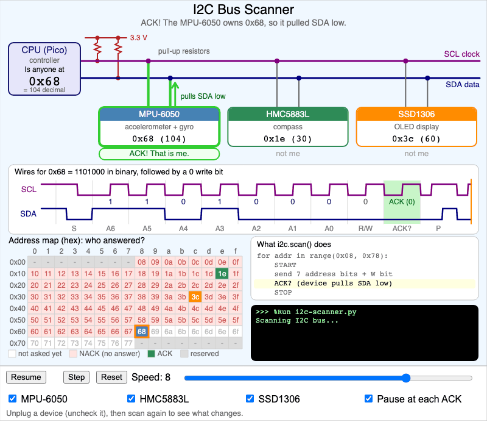
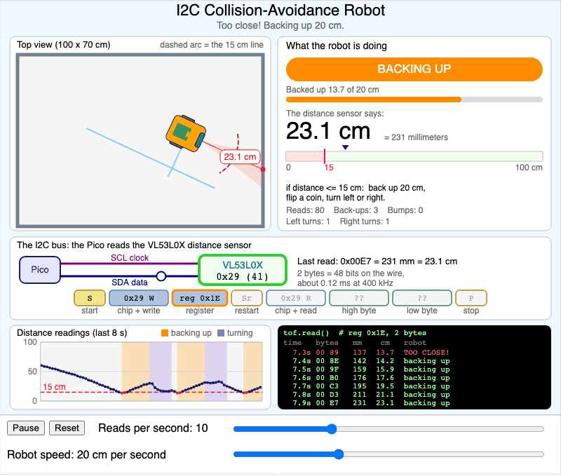
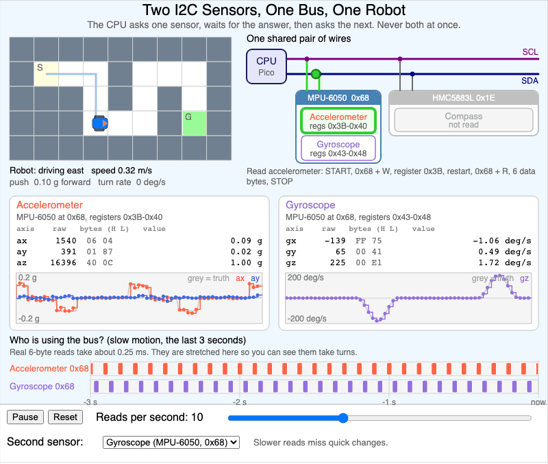
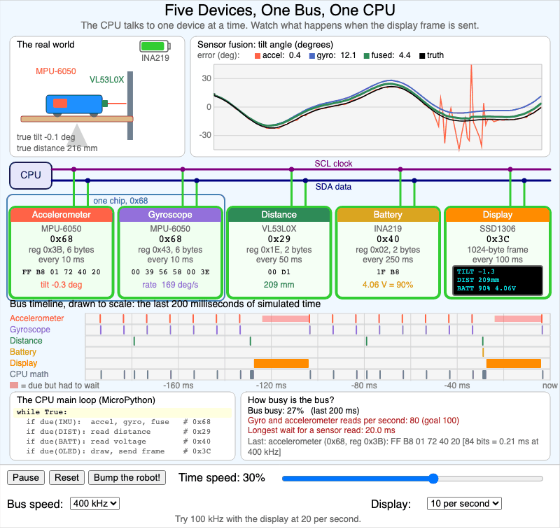

# I2C Simulations

These four MicroSims go with [Appendix A: The I2C Bus](i2c-bus/index.md). Do them in
order. Each one builds on the one before it.

  <a href="../../sims/i2c-scanner/" title="1. I2C Bus Scanner" style="display:block;border:1px solid #e3e7ec;border-radius:8px;overflow:hidden;text-decoration:none;color:inherit;box-shadow:0 1px 3px rgba(0,0,0,0.08);">1. I2C Bus Scanner</a>
  <a href="../../sims/i2c-collision-avoidance/" title="2. I2C Collision-Avoidance Robot" style="display:block;border:1px solid #e3e7ec;border-radius:8px;overflow:hidden;text-decoration:none;color:inherit;box-shadow:0 1px 3px rgba(0,0,0,0.08);">2. I2C Collision-Avoidance Robot</a>
  <a href="../../sims/i2c-two-sensors-maze/" title="3. I2C Two Sensors in a Maze" style="display:block;border:1px solid #e3e7ec;border-radius:8px;overflow:hidden;text-decoration:none;color:inherit;box-shadow:0 1px 3px rgba(0,0,0,0.08);">3. I2C Two Sensors in a Maze</a>
  <a href="../../sims/i2c-sensor-fusion/" title="4. I2C Five-Device Sensor Fusion" style="display:block;border:1px solid #e3e7ec;border-radius:8px;overflow:hidden;text-decoration:none;color:inherit;box-shadow:0 1px 3px rgba(0,0,0,0.08);">4. I2C Five-Device Sensor Fusion</a>

## What Each MicroSim Shows

1. **I2C Bus Scanner.** The Pico asks every address, "is anyone there?" Chips answer with an ACK. Unplug a chip and scan again.
2. **I2C Collision-Avoidance Robot.** One distance sensor on the I2C bus steers a robot. Within 15 cm of a wall, the robot backs up 20 cm and flips a coin to turn left or right. Slow the reads down and watch it bump.
3. **I2C Two Sensors in a Maze.** A robot drives a maze. The Pico reads an accelerometer, then a gyroscope or a compass, taking turns on one bus.
4. **I2C Five-Device Sensor Fusion.** Five devices share one bus. See a display picture block the sensors. Then fuse the accelerometer and the gyroscope into one clean angle.
